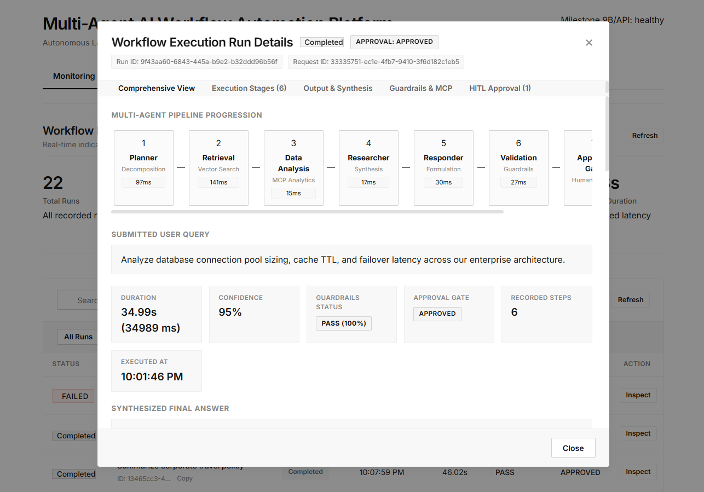
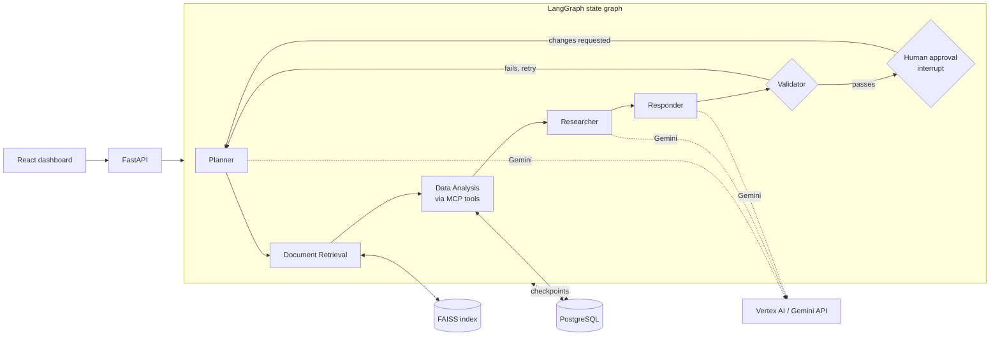

# Multi-Agent Workflow Platform

[](https://github.com/adityagupta74-ai/multi-agent-llm-workflow-platform/actions/workflows/ci.yml)


A multi-agent system that answers business questions over a company's **documents** and **structured data**. Answers come with citations and checked numbers. Sensitive answers wait for **human approval** before they're released.

Built with LangGraph, FastAPI, PostgreSQL, FAISS, the Model Context Protocol (MCP) and Google Gemini. It runs with Docker Compose locally, and a single script deploys it to Cloud Run.



---

## The problem

An operations team keeps asking questions like *"What was revenue by region last quarter, and does it comply with our discount policy?"* Answering means pulling numbers from a database, finding the relevant policy PDF, and combining the two. That's slow by hand. An unsupervised chatbot is risky: it can make up numbers or cite documents that don't exist.

This platform splits the work across specialised agents and **checks** the result before anyone sees it:

| Requirement | How it's handled |
|---|---|
| Answers grounded in company docs | RAG over uploaded PDF/TXT/Markdown files (chunked, embedded with Gemini, indexed in FAISS) |
| Numbers must be correct | The Data Analysis agent computes figures through **MCP tools** (read-only, parameterised SQL) instead of letting the LLM guess |
| No made-up facts or citations | A **Validation agent** checks every figure against the tool output and every citation against the index, then sends the answer back for correction (bounded retries) if needed |
| A human signs off on sensitive output | A LangGraph **interrupt** pauses the run at an approval gate. The reviewer can approve, reject or request changes |
| Runs survive restarts | State is checkpointed in PostgreSQL (`AsyncPostgresSaver`), so a paused run resumes even after a redeploy |
| Changes can be measured | A benchmark harness scores retrieval, citations, fact coverage and guardrails, and compares runs to catch regressions |

## Architecture



| Agent | Responsibility |
|---|---|
| **Planner** | Breaks the query into a goal and ordered steps (structured Pydantic output) |
| **Document Retrieval** | Embeds the query and pulls the top-k chunks with page-level provenance |
| **Data Analysis** | Decides whether numbers are needed, then calls MCP tools (`analyze_dataset`, `query_postgres`, `get_dataset_schema`) |
| **Researcher** | Reasons over the plan, retrieved evidence and computed metrics |
| **Responder** | Writes the final answer, key points, confidence and citations |
| **Validator** | Checks figures and citation provenance deterministically. Recoverable failures loop back with feedback |
| **Approval gate** | Pauses on `interrupt()` and resumes through `POST /api/v1/workflows/{id}/approval` |

There's more detail in [docs/architecture.md](docs/architecture.md).

## Quickstart

**Prerequisites:** Docker, plus a [Gemini API key](https://aistudio.google.com/apikey). You can skip the key by using `LLM_PROVIDER=mock`.

```bash
git clone https://github.com/adityagupta74-ai/multi-agent-llm-workflow-platform.git
cd multi-agent-llm-workflow-platform
cp .env.example .env            # set LLM_API_KEY, or LLM_PROVIDER=mock to run offline
docker compose up --build
```

| Service | URL |
|---|---|
| Dashboard | http://localhost:5173 |
| API docs (Swagger) | http://localhost:8000/docs |
| Readiness probe | http://localhost:8000/api/v1/health/ready |

Try it:
1. **Knowledge Base** tab: upload a PDF.
2. **Query Runner** tab: ask *"What is total revenue by region?"* or a question about your document.
3. **Approvals Queue** tab: approve, reject or request changes.
4. **Monitoring Dashboard** tab: open the run to see each agent's step, its latency and the guardrail results.

### LLM providers

| `LLM_PROVIDER` | Auth | Notes |
|---|---|---|
| `gemini` | `LLM_API_KEY` | Gemini API (AI Studio key). Default model `gemini-2.5-flash` |
| `vertex` | Application Default Credentials | Vertex AI. Needs `GOOGLE_CLOUD_PROJECT`. Used in the Cloud Run deployment |
| `openai` / `ollama` / `azure_openai` | `LLM_API_KEY`, `LLM_BASE_URL` | Any OpenAI-compatible endpoint |
| `mock` | none | Deterministic offline model, used by the test suite |

Embeddings are set independently with `EMBEDDING_PROVIDER`: `gemini` and `vertex` (`gemini-embedding-001` with retrieval task types and 768-dim truncation), plus `local`, `openai` and `mock`.

## Deploy to Google Cloud

```bash
export PROJECT_ID=your-gcp-project
./deploy/cloudrun/deploy.sh
```

The script provisions **Cloud Run** (backend and frontend), **Cloud SQL for PostgreSQL 16**, **Secret Manager** for the DB URL, a **Cloud Storage** volume for documents and the FAISS index, and a least-privilege service account that calls **Gemini on Vertex AI** (no API keys involved). It's idempotent. `teardown.sh` removes everything. See [deploy/cloudrun/README.md](deploy/cloudrun/README.md).

## API

| Method | Path | Purpose |
|---|---|---|
| `POST` | `/api/v1/workflows` | Run a query through the agent graph |
| `GET` | `/api/v1/workflows`, `/stats`, `/{run_id}` | Run history, aggregate metrics, per-step detail |
| `GET` / `POST` | `/api/v1/workflows/{run_id}/approval` | Inspect a pending approval, or submit approve / reject / changes requested |
| `GET` | `/api/v1/approvals/pending` | Approval queue |
| `POST` / `GET` / `DELETE` | `/api/v1/documents` | Upload, list and delete documents (indexed into FAISS) |
| `GET` | `/api/v1/analytics/datasets` | Datasets exposed to the MCP tools |
| `POST` / `GET` | `/api/v1/evaluations`, `/{id}/results`, `/{id}/report`, `/compare` | Run benchmarks and compare runs |
| `GET` | `/api/v1/health`, `/live`, `/ready` | Liveness and readiness probes (DB, checkpointer, index) |

## Evaluation

`backend/app/evaluation` contains a 35-case benchmark across 7 categories: answerable, multi-hop, unanswerable, ambiguous, citation-sensitive, unsupported-premise and retrieval edge cases. It reports:

- **Retrieval:** Recall@k, Precision@k, MRR, MAP, HitRate@1
- **Citations:** presence, ID/source/page validity, attribution match
- **Answers:** atomic fact coverage, abstention accuracy
- **Guardrails:** whether the validator correctly blocks or passes an answer

Runs are stored in PostgreSQL and can be compared side by side. The comparison flags each run as `IMPROVED`, `REGRESSED` or `NEUTRAL`. You can trigger a run from the **Evaluation Console** tab or with `POST /api/v1/evaluations`. Details are in [docs/evaluation.md](docs/evaluation.md).

## Development

```bash
python -m venv .venv && source .venv/bin/activate
pip install -r backend/requirements.txt
docker compose up -d postgres            # tests use a real PostgreSQL
docker compose exec postgres createdb -U postgres test_db
python -m pytest -q                      # backend suite (runs offline with the mock LLM)

cd frontend && npm ci && npm test && npm run dev
```

CI (GitHub Actions) runs the backend suite against PostgreSQL 16, and the frontend tests and build, on every push.

```
backend/app/
  agents/        planner, document_retrieval, data_analysis, researcher, responder, validation, approval
  graph/         LangGraph state, workflow wiring, Postgres checkpointer
  mcp/           MCP server + analysis tools
  documents/     loaders (PDF/TXT/MD), chunking, embeddings, FAISS store
  validation/    deterministic guardrails
  evaluation/    benchmark dataset, metrics, runner, reports
  api/routes/    FastAPI routers
frontend/src/    React dashboard, query runner, approvals, knowledge base, evaluation console
deploy/cloudrun/ Google Cloud deployment
```

## Design decisions

- **Deterministic validation, not LLM-as-judge.** Figures and citations are checked against tool outputs and the index. That makes the guardrail cheap, reproducible and testable in CI.
- **Tools behind MCP.** The LLM never writes raw SQL against production tables. It picks from an allow-listed set of parameterised operations.
- **LangGraph state is separate from the audit log.** Checkpoints exist so runs can resume. The `workflow_runs` and `workflow_steps` tables are the queryable audit trail for the dashboard.
- **FAISS on a mounted volume.** This keeps the deployment simple, but it limits the backend to a single writer (`max-instances=1`). The next step to scale out is Vertex AI Vector Search.

## Roadmap

- [ ] Swap FAISS for Vertex AI Vector Search to scale horizontally
- [ ] Stream agent progress to the UI over Server-Sent Events
- [ ] Add authentication and per-tenant document isolation
- [ ] Port the agents to Google's Agent Development Kit (ADK) and expose them over A2A

## License

[MIT](LICENSE)
